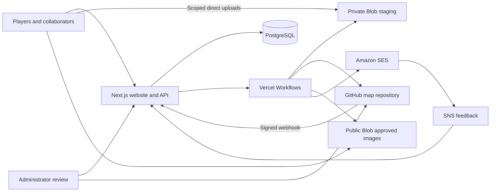

# Technical specification and implementation status

This is the canonical specification, plan, and test-evidence record. The owner confirmed on 2026-10-21 that the current repository is the latest deployed version. Deployment is the baseline, not evidence that every acceptance scenario has passed. Historical results below retain their original dates and limits; no live checks were rerun for this documentation consolidation.

See [deployment and testing procedures](DEPLOYMENT_TESTING.md) for commands and resource setup, and [contributor guidance](AGENTS.md) for essential constraints. Each subsystem places its specification before its implementation status and testing notes. Update all three together when behavior changes.

## Architecture and persistence

### Specification

Next.js and TypeScript run on the Node.js runtime on Vercel. PostgreSQL stores Better Auth accounts/sessions, profiles, permissions, edit sessions, durable operations/outboxes, rate counters, publication metadata, and email state. Octokit accesses GitHub; Vercel Blob stores staged and published images; Vercel Workflows runs durable operations. Versions are pinned through `package-lock.json`.

GitHub is authoritative for map history, issue/comment bodies, and PR status. PostgreSQL is authoritative for website accounts and workflow state. Keep website source and map data in separate repositories; map changes must not execute website code or receive application secrets. No mutable application state depends on a serverless filesystem or an in-memory counter.

| Migration                     | Responsibility                                                                                              |
| ----------------------------- | ----------------------------------------------------------------------------------------------------------- |
| `001_accounts.sql`            | Auth tables, profiles, invitations/resets, rate limits, settings, account audit.                            |
| `002_pipeline.sql`            | Edit sessions, uploads, operations, outbox, publications, webhook deliveries, GitHub cache, pipeline audit. |
| `003_email_notifications.sql` | Preferences, verification/unsubscribe tokens, email jobs/outbox, feedback, suppressions, launch cutoff.     |
| `004_email_daily_limit.sql`   | Durable per-account daily reservations and pending-job content enrichment.                                  |

Migrations record SHA-256 checksums and use a session advisory lock spanning transactions, requiring a direct database connection. Applied files are immutable. The email-only production command checks baseline 001/002 and all four checksums before applying only 003/004; it never falls back to the app database URL. Each migration commits separately, so a rerun resumes after the last successful one. HTTP requests never create schema.

| Code area                                                                             | Responsibility                                                                    |
| ------------------------------------------------------------------------------------- | --------------------------------------------------------------------------------- |
| `src/app`, `src/components`, `src/lib/i18n`                                           | Routes, public/collaborator/admin interfaces, locale catalogs.                    |
| `src/lib/contracts.ts`, `src/lib/schemas.ts`                                          | Shared types and authoritative input validation.                                  |
| `src/server/auth`, `src/server/security`, `src/server/db`                             | Accounts, authorization, abuse controls, persistence.                             |
| `src/server/github`, `src/server/maps`, `src/server/storage`, `src/server/operations` | GitHub integration, file validation, staging, idempotent operations, publication. |
| `src/server/email`, `src/workflows`                                                   | Email delivery/feedback and durable workflow entry points.                        |
| `migrations`, `scripts`, `tests`, `public/maps`                                       | Schema, operator/acceptance tools, tests, approved bootstrap map.                 |

### Status

**Implemented and deployed.** The local PostgreSQL helper provides persistent loopback-only development storage, a non-superuser application role, and a private peer-authenticated administrator socket. Its files live under ignored `.local/postgres/`; it starts manually after reboot. Database backups must include account and operation state; GitHub cannot restore these.

### Testing notes

The 2026-10-06 local database setup verified migration hashes, the then-current 18 tables, role permissions, UTF-8, loopback listening, advisory locks, and write/read/rollback. That table count predates email migrations. Later email validation is recorded below. `scripts/test-email-migrations.ts` exercises the production migration command against isolated local schemas, including target isolation and prerequisite/checksum guards; its existence alone is not a recorded passing run.

## Accounts, authorization, and abuse controls

### Specification

Accounts use email/password login plus an in-game display name. Administrators create invitations and reset links; public registration and public bootstrap are disabled. Invitation secrets are single-use, email/role-bound, hashed in storage, and expire after 24 hours; reset links expire after one hour. Bootstrap is an interactive operator command and refuses if an administrator already exists.

Passwords contain 8–128 characters, including spaces, and are never trimmed or logged. Argon2id uses independent salts with a baseline of 19 MiB, two iterations, parallelism one, and login rehashing when parameters change. Better Auth manages seven-day sessions with 15-minute freshness for administrative mutations. HTTPS cookies are secure, HttpOnly, and SameSite; state-changing browser requests require the configured origin. Disabling accounts and resetting passwords revoke sessions; authorization rechecks active profile and role, including queued work and upload access.

Map-update fresh-authentication prompts return the user to the localized Updates page after sign-in. Submission-form prompts and actions in **My updates** target `#my-updates`; actions in **Updates from others** target `#other-updates`. The page scrolls to the section after the draft and history load, below the sticky header. These are fixed, allowlisted login destinations; existing ordinary login, administrator, settings, and notification destinations retain their behavior. Signing in does not automatically replay a rejected action; the user reviews and retries it.

| Actor                    | Capabilities                                                                                                                                                                                                              |
| ------------------------ | ------------------------------------------------------------------------------------------------------------------------------------------------------------------------------------------------------------------------- |
| Visitor                  | Read the approved map/eligible discussions and submit protected requests/comments.                                                                                                                                        |
| Active collaborator      | Visitor capabilities, close public requests, download source, create edit sessions/uploads/PR submissions, view own operations, delete own inactive updates.                                                              |
| Website administrator    | Collaborator capabilities, invitations/accounts, public-write pause, diagnostics/retry/sync, review/merge/close, edit any open update PR, recover others' failed updates, delete inactive updates, and rollback controls. |
| Repository administrator | Repository rules, validation installation, direct GitHub review/moderation and merges.                                                                                                                                    |

Signed-in submissions use the profile's in-game name in both UI and API. The field is visibly disabled. Guests cannot impersonate registered names. Comment `nameVerification` is computed at read time from website attribution, including supported legacy recovery; it is not a database column and does not verify Minecraft identity ownership.

Turnstile verification checks hostname/action for public submissions; retries of accepted operations do not replay a consumed challenge. Persistent rate limits use atomic fixed windows and keyed IP digests. Production trusts only Vercel's overwritten IP header when both `VERCEL=1` and `TRUST_PROXY=vercel`; unsupported production proxy configuration fails closed. Development uses one shared IP bucket.

| Limit                               | Default                                    |
| ----------------------------------- | ------------------------------------------ |
| New requests per IP                 | 3/hour, 10/day                             |
| New comments per IP                 | 10/hour, 30/day                            |
| Selected guest mentions per IP      | 3/day                                      |
| Login                               | 5/account-IP pair and 30/IP per 15 minutes |
| Public writes globally              | 60/hour                                    |
| Update submissions per collaborator | 5/hour                                     |

Request/comment and guest-mention limits are configurable positive integers; invalid values fall back to defaults. `DISABLE_RATE_LIMITS=true` works only in development/test. It does not bypass authentication, Turnstile, or the public-write pause. Protect submitted text and GitHub Markdown: escape untrusted content, neutralize unintended mentions/closing directives, restrict public issue eligibility, and do not render raw HTML or arbitrary tracking images. Logs exclude credentials, raw IPs, private URLs, and token links.

### Status

**Implemented and deployed.** The eight-character minimum supersedes the original twelve-character proposal. Website administrator confirmation now supports merging in addition to direct GitHub review. No migration was introduced for computed name verification.

**2026-10-22 reauthentication return navigation:** Implemented locally; not deployed. Map-update prompts use a section-scoped destination, including errors displayed by nested operation progress. Authentication requirements remain enforced by the existing server handlers.

### Testing notes

**2026-10-22 reauthentication return navigation:** All 38 focused mocked browser cases passed across focused runs: create/merge/close returns in all three locales, draft preservation, delayed authentication/history loading, no automatic mutation replay, existing login destinations, administrator fallback, and existing invitation/map-action/update-management behavior. Desktop and mobile return-section screenshots were inspected. The 19 unit-test files, typecheck, production build, formatting, and `git diff --check` passed. These are local UI checks; no hosted authentication or GitHub writes were exercised.

Existing unit/browser coverage includes password primitives, bootstrap errors, invitation/settings flows, collaborator restrictions, and account-name enforcement. The 2026-10-06 record established focused login/service connectivity, not a full account acceptance pass. Repeatable acceptance must include invite/reset races, disabled-session and upload revocation, role/public-signup bypass rejection, distinct salted hashes, real challenge success/rejection, and production cookie/origin behavior; see the operator guide. Later 2026-10-21 suite results appear in the email section and do not establish every hosted scenario.

## Requests and discussions

### Specification

General thoughts contain an in-game name and comment. Line requests contain Add/Update, optional line name and **string** line number, line type, an ordered station list, optional notes, and `notifyAdmins` defaulting to true. Station lists represent the complete proposed ordering. Line types are double/single-track blue ice, double/single-track rail, or other.

| Input              | Contract                                                                                                               |
| ------------------ | ---------------------------------------------------------------------------------------------------------------------- |
| In-game name       | Required; up to 64 Unicode characters; signed-in identity enforced server-side.                                        |
| Line name / number | Optional; up to 120 / 32 characters; values such as `01`, `2A`, `7.5` remain strings.                                  |
| Stations           | 1–200 ordered entries; Chinese name required, English optional, each up to 120 characters.                             |
| Coordinates        | Signed safe-integer X/Z; no Y or invented world boundary.                                                              |
| Dimension          | Free text, up to 128 characters; missing/blank defaults to literal `overworld`. Preserve case, spaces, and namespaces. |
| Comments / notes   | Up to 5,000 Unicode characters; comments required, notes optional.                                                     |
| Selected mentions  | Up to 20 account selections with validated text offsets.                                                               |

Names/dimensions trim surrounding whitespace; absent optional names/identifiers become null. Unknown write fields are rejected by strict schemas where defined. The editor JSON format is separate from these station request schemas.

Issues use server-selected `metro-request`, `type:general`, `type:line-update`, and `operation:add`/`operation:update` labels, a stable operation marker, and a human-readable template. Public issue access excludes PRs and unrelated/unlabeled issues. Comments are chronological and paginated; only open, unlocked eligible issues accept new comments, rechecked before writing. Replies must target a comment in the same discussion. Direct GitHub administrator replies remain visible.

Replies and account mentions apply consistently to comments and general thoughts. Plain `@` text is not an account selection. Each distinct selected guest mention consumes its separate daily allowance. Entering a name alone never grants edit/delete/close permissions. Active collaborators/admins can close public requests.

### Status

**Implemented and deployed.** Replies/mentions use existing operation payloads, guest allowance uses `metro_rate_limits`, and identity labels are computed; these features did not require new migrations.

### Testing notes

Unit coverage includes schemas, request eligibility/closing, reply target and mention validation, rate limits, and safe GitHub templates. Browser coverage includes discussion and collaborator access. Acceptance includes Chinese text, missing English names/line identifiers, string line numbers, custom/default dimensions, closed/locked/unlabeled discussions, chronological pagination, spoofed names, script/Markdown injection, selected versus plain-text mentions, and draft preservation on failure. Do not interpret old unexecuted checklists as passing evidence.

## Map edit sessions, uploads, and format

### Specification

The separate data repository is [ofts-cqm/ckocc-metro-map](https://github.com/ofts-cqm/ckocc-metro-map); the optional local checkout `map-data/` is ignored. Only `maps/network.json`, `maps/network.png`, and `maps/manifest.json` are updated by ordinary website map submissions, together in one commit. The public repository independently exposes JSON even though the website source-download route requires collaborator authorization.

The server records an edit session's base commit and map revision; writable drafts expire after seven days. Previously downloaded sources can identify an approved historical commit or map revision, resolved against default-branch history rather than unmerged PRs or individual file hashes. Collaborators download that pinned JSON, edit externally in Rail Map Painter, then upload JSON/PNG and a summary (up to 160 characters), optional details (5,000), and up to 50 selected issue numbers. Do not label an unknown-origin export as based on the current map. A stale map needs manual reconciliation in the editor; arbitrary whole-document JSON merging is outside this design.

Files upload directly to private Blob storage using scoped server-issued tokens, avoiding function payload limits. Tokens/references bind the account, edit session, generated path, type, size, and expiry. The server checks trusted stored content and ownership, not browser claims or arbitrary URLs. Upload completion validates the actual JSON document or fully decodes the PNG before marking it ready. Submission revalidates the selected stored pair before creating an operation or locking the draft; invalid files return a field error while the draft stays editable. The queued worker validates again before GitHub writes. The editable form displays its error notice directly above the JSON/PNG upload boxes, inside the upload panel.

| Constraint                  | Value                                                                   |
| --------------------------- | ----------------------------------------------------------------------- |
| JSON / PNG bytes            | 2 MiB / 20 MiB                                                          |
| PNG dimensions              | At most 24,576 per axis and 200 million pixels                          |
| Staging quota               | 128 MiB/account, 1 GiB globally                                         |
| Abandoned staging retention | Seven days, retaining assets needed by live/failed/uncertain operations |

Staging quota charges trusted stored byte sizes for ready uploads, falling back to their full reservation when size is unavailable. Unfinished uploads retain the maximum JSON/PNG reservation until completion or confirmed deletion. Deleted uploads are excluded; completed, expired-but-retained assets still consume their actual bytes. The same calculation applies to account and global quotas under the shared staging advisory lock. A quota rejection returns `storage_quota_exceeded` (429) and a storage-specific message; request-rate bypass settings do not disable storage quotas.

RMP documents are accepted by structural validation, without a version allowlist. Require positive safe-integer version metadata, but permit older or future version numbers when the validated envelope and graph remain compatible. An RMP version bump alone must not reject a valid export; backward compatibility in RMP does not guarantee all future schema changes will pass these checks. Manifests record the actual document version and must match the original JSON. Validate UTF-8, editor envelope, unique node/edge keys, graph references, numeric diagram positions, PNG signature/chunk CRCs, complete bounded decoding, and reject APNG. Preserve unknown editor fields and original bytes. Diagram node X/Y is not Minecraft station X/Z; graph node/edge counts are not station/line counts. Human review must still establish that PNG and JSON represent the same map.

For a permanently failed update with no external write checkpoint or live worker lease, its owner or a freshly authenticated administrator can choose **Try again** in the active submission panel or **Edit and resubmit** in an expanded **My updates** history entry to restore summary, details, selected issues, and the original map base into a new editable session. JSON/PNG must be selected again. History recovery works without a receipt in browser storage, scrolls to the recovered form, and requires confirmation before replacing a different open draft. Historical errors remain labeled as the prior rejection. The history API exposes recovery to the owner and administrators, but only the editor who owns an existing replacement can resume it; submitted or expired replacements are hidden. A closed-unmerged update can also become a replacement after an authoritative check that its PR remains closed. The original contributor remains recorded on the source operation; a replacement submission belongs to its submitting editor. Recovery is transactional and repeat requests return the same unexpired draft. The failed operation and its uploads remain intact; its replacement-session checkpoint prevents worker leases and administrator retries. Failures with external write checkpoints, automatic retries, or uncertain outcomes require administrator reconciliation and cannot become replacement drafts.

Manifest schema version 1 records editor/version, operation, contributor, summary, selected issues, timestamp, base commit/revision, file paths/digests/sizes, and PNG dimensions. The revision is `sha256:` plus SHA-256 of `jsonDigest + "\n" + pngDigest + "\n"`; changing metadata alone does not change it. Null base values are valid only for bootstrap. No private account/contact/credential data belongs in the manifest.

### Status

**Implemented and deployed baseline; 2026-10-22 validation/recovery changes are implemented locally and await deployment.** The original map pair was imported byte-for-byte on 2026-10-06 in commit `0f1848d30952bd0857a265867473db8586a911bd`, with revision `sha256:ea26faf2bb455a6319e236f538f1e5d3da700500e101e386a9855fa9701c1bc3`. This is a historical bootstrap record, not the current publication pointer.

### Testing notes

**2026-10-22 upload error placement:** Implemented locally: the form error block moved from the final review section to immediately above the JSON/PNG upload boxes. Typecheck, formatting, and two mocked browser checks passed; desktop and mobile screenshots were inspected. Browser checks confirmed the alert immediately precedes the upload grid, including repeated quota failures. This UI change has not been deployed; provider behavior was not tested.

**2026-10-22 investigation and local changes:** A read-only production transaction found two updates failed with `unsupported_map_format` (one attempt each) and no GitHub write checkpoints. The supplied root export is an RMP v81 document, rejected by the old v80-only allowlist. The version allowlist has been removed in favor of structural validation, including future compatible versions. With the updated validator, its unchanged bytes pass document checks (413 graph nodes, 280 edges). Upstream's [v80-to-v81 migration](https://github.com/railmapgen/rmp/blob/main/src/util/save.ts) changes station-resource attributes; the validated envelope and graph-reference structure remain compatible. The JSON alone does not establish PNG validity or visual correspondence. No production rows were changed and no migration is required. Local evidence: all 18 unit-test files and three standalone Python-validator tests passed; all 38 browser tests passed, including regressions that verify editable recovery, required file reselection, reload persistence, and rejection without a receipt. The recovered form screenshot was inspected. An isolated local PostgreSQL test verified six simultaneous recoveries create exactly one replacement draft/audit and block old retries/worker leases. Typecheck and production build passed. The website and trusted data-repository validator must both be deployed; hosted upload callbacks, production memory/timing, and end-to-end PR acceptance remain unverified for this change.

**2026-10-22 local upload-quota investigation:** `/api/uploads/reserve` rejected another PNG because five ready PNGs and six ready JSON uploads were charged 112 MiB of maximum reservations despite only about 16 MiB stored. Quota aggregation now uses their trusted stored sizes, including existing rows, with no migration or reset. Read-only diagnosis did not change user uploads. Local quota integration passed for the reported pattern, full pending reservations, missing-size fallback, deleted exclusion, global accounting, and concurrent reservations. All 18 unit-test files, typecheck, production build, and both targeted browser tests passed; the browser test checks storage-specific errors, preserved text, and repeated file selection after a 429. Existing mocked browser checks had not covered this accumulated database quota state. Hosted Blob storage usage is not established by these database checks.

**2026-10-22 historical recovery correction:** The first recovery implementation covered only the active receipt panel; expanded history rows displayed saved format errors with no recovery action. Production inspection confirmed the original two failures still had no recovery checkpoint (read-only; no production mutations). Added owner-scoped recovery to saved history, including recovery without a browser receipt, current-draft replacement confirmation, retryable request errors, and visibility rules for submitted/expired replacement sessions. Unit coverage exercises ownership, write/uncertainty exclusions, and replacement expiry. All 18 unit-test files, four focused browser scenarios, typecheck, and production build passed. The recovered form screenshot was inspected; history browser checks reported no unhandled page errors. An isolated PostgreSQL run passed history eligibility and replacement-state checks alongside six-way recovery concurrency. Website deployment and hosted user acceptance remain pending.

The original 198,454-byte JSON and 7,362,193-byte PNG passed graph/PNG checks; a decoded preview was visually inspected. The PNG is 17,577 × 9,095 pixels. Initial storage checks verified both stores by round trip, private unauthenticated reads returning 403, and public reads succeeding, then deleted temporary objects. Unit coverage includes map validation and edit sessions; browser coverage includes map versions. Acceptance includes wrong types/corruption/oversize, unauthorized references, source pinning, upload/reload recovery, and reopening exports in the editor. Hosted callbacks and runtime memory limits require hosted checks.

## GitHub operations, merging, and rollback

### Specification

Use GitHub App installation authentication scoped to the configured data repository. Contents, Issues, and Pull requests need write access; Metadata and Checks need read access. The optional PAT takes precedence if configured and must have the expected actor login. Runtime credentials do not receive Workflows/Administration permission or a bypass of validation/freshness rules.

Accepted writes persist an operation, canonical request digest, actor or hashed anonymous receipt, timestamp, lease, checkpoints, and outbox before launching workflows. `Idempotency-Key` is a UUID: identical retries return the same receipt; conflicting payloads conflict. Anonymous result access requires its separate receipt credential, not knowledge of the operation/key alone.

Map work validates ownership, selected issues, files, and base freshness, rejects no-op pairs, then creates blobs/tree, one commit, a deterministic `metro-update/<operation-id>` branch, and a PR. Preserve all other repository files. Only explicitly selected eligible issues receive generated closing directives; those issues close on default-branch merge, not PR submission or unmerged closure.

Record intent before external writes and identifiers after success. Retry reconciliation uses exact markers, expected actor/body, paginated listings, deterministic branches and PR identity. Ambiguous outcomes remain `outcome_unknown` until reconciled; do not blindly repeat a content-creation POST. Distinguish operation completion, merged PR state, and publication state.

Repository `validate-map` runs trusted validation from the protected default branch, treating candidate content as data. It checks path allowlists, hashes, manifest, formats, and original base revision. Require up-to-date branches with no validation bypass: GitHub's Update branch cannot make an obsolete manifest current. The merge API pins the PR head but cannot condition on an expected default-branch SHA, so strict repository freshness rules are essential.

When the approved JSON/PNG still match the contributor's recorded base but `main` has advanced, pending website-created update/rollback PRs automatically catch up after maintenance. Webhook/read/repair reconciliation queues up to 25 matching pending updates; opening merge review also queues catch-up immediately. New PRs are constructed on current approved `main` when its map revision still matches, while the manifest continues to record the contributor's actual edit base. This does not relabel the export or merge map documents.

Catch-up is a durable `refresh-update` operation owned by the original active contributor and deduplicated by source PR head plus target `main` SHA. It verifies repository, PR identity, approved original/current maps, original edit base, and fixed-path-only changes. It builds a two-parent commit from the pinned approved `main` tree with the submitted JSON, PNG, and manifest copied byte-for-byte, then advances only the PR branch with `force=false`. It records planned commit and ref-write intent before updating the branch, preserves the initial PR head, and updates the expected head only after authoritative ref observation. Uncertain writes remain `outcome_unknown`; later automatic requests retain the same intent and cannot blindly repeat the write. Changed maps require reconciliation; unexpected PR changes, disabled contributors, closed PRs, and superseded target commits do not authorize a branch write. No catch-up operation merges or publishes a map.

After catch-up, old checks do not authorize merging. Review waits for trusted validation of the current PR head or a verified test-merge commit whose parents include both the current head and current `main`. Cached old PR/test-merge reads produce pending status and continued review polling. Strict up-to-date GitHub validation and the separate merger-identity rules remain enforced. The UI distinguishes maintenance in progress, waiting for new checks, map reconciliation, conflicts, and uncertain/failed maintenance updates, and links to GitHub merge details.

Administrators review **Merge PR** on Updates with live validation status (15-second visible refresh and manual refresh). Failed refresh clears readiness. The server checks fresh admin authentication, website-created operation identity, pinned head/base, valid files, trusted successful `validate-map`, and repository protection; GitHub enforces final permissions/rules. `mergeable_state=blocked` alone is not a rejection when a restrict-updates ruleset permits the app to merge through PRs.

**Create rollback PR** restores the complete pair from before a selected website-created merge, with a fresh manifest based on current HEAD. It removes later changes only when separately reviewed/merged; resolved issues stay closed. Current publication labeling follows the current manifest's operation, not every historical publication. Administrators see independent paginated **My updates** and **Updates from others** sections (10 each), collapsed by default, with review controls in either section.

Administrators can **Close without merge** from an expanded open PR. Confirmation queues a durable `close-update` operation; it rechecks active administrator role and the persisted repository/PR number and original bot creator before closing, never merges or publishes, and records `closed_unmerged` on the source update. Closing does not require a pinned head, unchanged description/operation marker or branches, passing validation, a fresh map base, or mergeability. Those mutable checks remain required for merge/edit flows. A lost response is reconciled by reading the recorded PR identity and state; an inconclusive lookup retains `outcome_unknown` and does not send another close request.

**Delete update** removes an inactive update from the portal history. Collaborators may delete their own updates; administrators may delete anyone's, with fresh authentication. Failed/reconciliation entries must have no PR-creation uncertainty or automatic retry; closed/merged entries require a live check of the recorded PR identity and that the PR is not open, without merge/edit content validation. Live worker leases and pending/uncertain PR actions block deletion. The deletion marker and audit are transactional and idempotent; original data, GitHub PRs, and publication records are retained. Deleted operations cannot be leased or retried. This is removal from portal history, not a GitHub deletion or publication rollback.

Administrators can **Edit update** on any open website PR, including another contributor's. This opens an administrator-owned draft containing the existing summary, details, issue selections, and unchanged recorded base; its source download is the submitted PR JSON pinned to the reviewed head. Replacement JSON/PNG must be selected. **Save changes to PR** queues `edit-update`, validates ownership, files, eligible issues and base freshness, and commits the pair plus manifest atomically to the same PR branch without force. It updates the existing PR title/body and expected head/revision while preserving its number, original contributor, operation marker, and recorded base. Separate action payloads/checkpoints/audit retain the editor and previous metadata. Any changed PR head or base requires renewed review/reconciliation; no map documents are automatically merged. Old validation checks cannot approve the new head. Merged updates remain immutable; use the existing rollback workflow to change an approved map.

Before close acceptance, an active administrator can automatically reconcile an uncertain maintenance action when the recorded planned commit matches the authoritative GitHub branch reference and PR identity. The source commit pointer, maintenance result, outbox, and audit are updated transactionally; this reconciliation performs no GitHub writes. Live leases, changed identity/ref, unavailable evidence, or competing retries preserve the blocker. Busy-action errors distinguish pending/uncertain work from an active PR.

PR-action acceptance locks the source update and rejects overlapping merge, close, edit, and maintenance actions; manual retries also check for competing actions. Ref and metadata write intents are persisted separately. Uncertain responses are lookup-only until the planned branch head and exact PR metadata are observed. An abandoned editable PR session can be resumed by its editor until expiry; another administrator cannot take over that live draft. Administrator edits do not require the original contributor to remain active.

The administration attention list is reconciled on load and during normal PR synchronization (read-triggered sync, webhooks, and repair). Failed or `needs_reconciliation` merge/close/edit/maintenance actions that never recorded a PR write intent/result become terminal `superseded` when their source update is closed/merged/published and a live check confirms the recorded PR is closed. The UI labels this **No longer needed**, rather than reporting the attempted action as successful. Reconciliation retains the original status/error and observed PR outcome in the checkpoint, writes one audit entry, stops the outbox, and prevents leasing/retrying that attempt. A new authorized merge does not deduplicate to a superseded attempt. Scans are bounded to 50 candidates; locked or actively leased rows are skipped. Open/reopened PRs, mismatched identities, unavailable evidence, uncertain writes, and unresolved publication work stay visible. No GitHub or Blob mutations are performed by this reconciliation.

### Status

**Implemented and deployed baseline; automatic maintenance catch-up and update management (close, delete, administrator editing) are implemented locally and await website deployment.** Review, merge, rollback, catch-up, close, delete, and editing reuse operations/outbox/audit tables without a migration. `WEBSITE_MERGES_ENABLED` is an environment gate defaulting to false; deployment does not change that code default. New installations must validate protections before enabling it. Direct GitHub review remains supported.

### Testing notes

**2026-10-22 update management:** Local unit coverage exercises authorization, another contributor's in-place PR edit, exact uploaded bytes, retained PR/author/base, stale heads/bases, queued role revocation, and close/ref/metadata timeouts without duplicate writes. Isolated local PostgreSQL acceptance confirms administrator-owned recovery, one audit for six simultaneous deletions, hidden deleted history, blocked old leases/retries, six concurrent PR-edit requests sharing one draft without exhausting the connection pool, and exactly one accepted action across six concurrent PR-action submissions. A manually retried action reserves its source before the worker starts. Browser coverage exercises role-specific controls, confirmation cancellation, API errors, persisted editing drafts, required replacement uploads, and close completion. All 19 unit-test files, 44 browser tests, typecheck, production build, formatting and diff checks passed; desktop and narrow mobile screenshots were inspected. Provider responses are mocked for these new actions; live GitHub edit/close and hosted workflow/Blob acceptance remain unverified. No production resources were modified and no migration is required.

**2026-10-22 close-validation correction:** Closing originally reused the merge/edit pinned-head and metadata checks, which could reject a changed PR with `pr_identity_changed`. Close acceptance, execution, response reconciliation, and inactive-PR deletion now use the persisted repository/PR number and original bot creator only. Regressions cover changed heads/descriptions/branches, failed checks, invalid map content, stale bases, unmergeable/draft PRs, deleted head repositories, and content changes between acceptance and execution; mismatched repository/creator/number and merged PRs still fail. Strict merge/edit identity checks are retained. All 19 unit-test files (including 45 map-action cases), three focused browser tests, typecheck, production build, formatting and diff checks passed. Provider responses are mocked; live provider acceptance remains unverified.

**2026-10-22 PR #16 close blocker:** Read-only inspection of the dedicated test repository and local development database found a `refresh-update` action in `outcome_unknown` while GitHub's PR head and branch reference both matched its planned commit `cc11960001b21bdf9b12f9c2b962d0684be6ad74`. The source still recorded the previous head; action serialization therefore returned `update_busy` before accepting close. The underlying reason the original write was not confirmed is not established. Close acceptance now reconciles confirmed maintenance completion before checking for competing actions. Isolated PostgreSQL regressions cover six simultaneous reconciliations producing one audit, acceptance of close afterward, and preservation of blockers for differing/unavailable evidence, mismatched creator, missing planned commit, live leases, racing retries/source changes, and inactive/demoted administrators. All 19 unit-test files, the isolated PostgreSQL acceptance, three focused browser tests (including the distinct busy message and close retry), typecheck, production build, formatting and diff checks passed. Provider responses in regression tests are mocked. This inspection did not close/merge PR #16 or manually clear its records. The automatic close/reconciliation path still needs a live end-to-end retry.

**2026-10-22 stale administrator attention:** The remaining local alert was merge operation `97fdf3bc-77c4-4e20-a127-e107a8df7bf3`, rejected with `stale_base_revision` before recording a write intent on October 10. Its parent update was already closed, and a live GitHub read confirmed test [PR #11](https://github.com/ofts-cqm/ckocc-metro-map-test/pull/11) remained closed/unmerged. Previous PR synchronization updated the parent but not obsolete child actions. After the new automatic reconciliation ran locally, the attempt was `superseded` with its original error retained and zero operations remained in attention states. A subsequent guarded local reconciliation pass made zero further changes. No GitHub PR, map, or production resource was changed. Isolated PostgreSQL checks cover all four action kinds, closed and merged PRs, six concurrent scans with one audit, stopped retries/leases, new merge deduplication, unavailable/mismatched/open PR evidence, active leases, write uncertainty, publication failures, and races with retries/new intents/source reopening. All 19 unit-test files, four focused browser tests, typecheck, production build, formatting and diff checks passed. Browser API responses and PostgreSQL test provider reads are mocked; hosted deployment remains pending.

**2026-10-22 automatic maintenance catch-up:** Production PR #12 had a passing check but was behind `main` after validator maintenance while its recorded base map revision still matched the approved map. The website previously reported a generic merge blocker. Added automatic queued catch-up and distinct UI reasons without changing repository protections or credentials. Unit coverage includes exact JSON/PNG/manifest preservation, current tree/parents, recorded edit-base preservation, changed-map/unexpected-file/inactive-account rejection, lost ref responses, uncertainty persistence, and cached PR/test-merge handling. All 18 unit-test files, 41 browser tests, typecheck, and production build passed. Isolated PostgreSQL acceptance verified eight simultaneous requests plus background reconciliation share one operation/outbox, retain unknown-write intent, and skip changed-map/inactive-author submissions.

Live runtime-App acceptance used a disposable draft in the dedicated test repository, [PR #22](https://github.com/ofts-cqm/ckocc-metro-map-test/pull/22). Catch-up preserved all three map files exactly, retained current non-map files, brought the branch up to date, and passed [fresh trusted validation](https://github.com/ofts-cqm/ckocc-metro-map-test/actions/runs/39865815290/job/120127616246). `main` stayed unchanged, no merge was attempted, and the draft/temporary branch and local schema were removed. App permission metadata confirmed Contents/Pull requests write and Checks read, with no Workflows or Administration permission. An earlier disposable run, PR #21, exposed GitHub PR-read caching after a successful ref update; the worker now reconciles the authoritative branch ref. Local queue/UI and real GitHub mutation/check acceptance do not establish hosted workflow/webhook scheduling, runtime resource limits, or the final production merge/publication scenario; those remain deployment acceptance checks.

Live acceptance on 2026-10-10 verified the installed workflow and active rulesets in `ofts-cqm/ckocc-metro-map-test`, using the website's GitHub App credentials, real operation workers, local PostgreSQL, and Blob storage:

- [PR #10](https://github.com/ofts-cqm/ckocc-metro-map-test/pull/10) passed `validate-map`, merged, and published. [Competing PR #11](https://github.com/ofts-cqm/ckocc-metro-map-test/pull/11) then failed with `stale_base_revision`; GitHub also rejected its merge with HTTP 405.
- [Invalid PR #12](https://github.com/ofts-cqm/ckocc-metro-map-test/pull/12) failed validation with `Expected an RMP v80 document`; GitHub rejected its merge with HTTP 405.
- [Rollback PR #13](https://github.com/ofts-cqm/ckocc-metro-map-test/pull/13) passed validation and restored the original JSON/PNG bytes and published revision. A simulated publication failure preserved the successful merge record; retry restored publication without another merge commit.
- Repeated merge and rollback confirmations with different idempotency keys returned the same respective operations.

The test exposed a GitHub ruleset compatibility issue: `mergeable_state` can remain `blocked` under restrict-updates rules even when the app may merge through PRs. Readiness now permits that state after checking the candidate and trusted validation result; GitHub's merge endpoint enforces branch rules and caller permissions. Nineteen focused server tests and typechecking passed after this fix.

These were worker-level live tests; hosted browser authentication and Vercel Workflow dispatch were not exercised. `WEBSITE_MERGES_ENABLED=true` was set only inside the test process. No production data or branch protections were changed. For installations, pin the checkout action to a verified release commit; see the operator guide.

## Publication, synchronization, and recovery

### Specification

Signed GitHub webhooks for Push, Pull request, Issues, and Issue comment events validate raw-body HMAC and configured repository/installation, deduplicate delivery IDs, persist work, and reconcile current state. Never trust event arrival order as publication order.

Publication reads all three files at one default-branch commit, validates them, and writes immutable public original/overview PNGs. A per-repository lock and final branch recheck prevent older work overwriting newer publication. The database current pointer changes only when assets are ready. Failures preserve the last good map and distinguish merged/publication-pending from published; publication retries do not merge again. An approved rollback is another normal validated publication.

Before first publication, the viewer shows the approved bootstrap reference snapshot. The initial display uses a bounded overview (up to 2,400 × 2,400); the original remains separately available. Deep zoom currently enlarges the overview. Source download is authorized and commit-pinned; public image delivery uses CDN URLs, not a large function response.

Issue caches and read-triggered reconciliation reduce stale state without blocking map metadata/saved history on background work. Without public Blob configuration, refresh can inspect PR status but skips publication. Outbox/repair recovers missed launches and performs cleanup. Expired rate/session/verification records are removed; expired invitations have a 30-day grace period, and account audit records older than 180 days are removed except persistent inbox read markers. Normal jobs launch immediately; `vercel.json` schedules repair at 04:23 UTC daily. Manual admin retry/sync can recover sooner.

### Status

**Implemented and deployed.** Last-good publication, immutable originals/overviews, bootstrap fallback, webhook ingestion, daily repair, and admin recovery are present. Image tiling remains a future enhancement if visual review establishes a need for sharper in-viewer deep zoom.

### Testing notes

On 2026-10-06, a real Workflow initial-publication failure exposed incorrect Blob-not-found detection. Switching to the SDK error class fixed it; Workflow retry stored the test publication and its overview returned HTTP 200. The 2026-10-10 merge/rollback run above covered publication recovery at worker level. Unit tests cover publication/map actions. Repeat acceptance includes duplicate/missed/out-of-order webhooks, concurrent edits, unmerged PR closure, preserved last-good image, and authenticated repair; hosted dispatch evidence is separate.

## Website inbox

### Specification

Successful operations are durable inbox events; notifications are derived from `metro_operations`, and read-through markers are `notifications.viewed` entries in `metro_audit`. There is no independently editable website notification-delivery table. Active accounts receive relevant replies, selected mentions, and administrator line-request alerts when requested. Exclude self-notifications; reply classification takes precedence over mention for the same source/recipient. Read markers affect only website unread state.

### Status

**Implemented and deployed.** Inbox/replies/mentions use existing pipeline/account tables without a migration. Email persistence below is separate, and neither email suppression nor failure removes an inbox item or marks it read.

### Testing notes

Discussion/mention tests cover source and recipient validation; email job tests reuse the same recipient predicates. Acceptance includes reply-plus-mention deduplication, inactive/self exclusion, administrator opt-in on line requests, and inbox read persistence across sessions.

## Email notifications

### Specification

One explicit opt-in covers replies, mentions, and applicable administrator alerts. Preferences and proof of mailbox ownership are both required. Administrator-entered addresses are initially unverified. Successful source operations enqueue one durable job per recipient using inbox predicates; failed/self/historical operations do not. Migration 003 records the launch cutoff and leaves existing users opted out; historical notifications are not backfilled.

Settings supports verification and password-protected address replacement. The old login address remains until the new one is verified, then sessions are revoked. Opt-out/address changes invalidate queued notifications; active account, address snapshot, verification, preference, and suppression are rechecked before sending.

Verification links expire after one hour; unsubscribe links after one year. Scoped tokens travel in URL fragments, are removed by confirmation pages, and require a confirmation POST to change state. Only token hashes are stored; a domain-separated HMAC reconstructs tokens for sending. `EMAIL_TOKEN_SECRET` can separate signing from the auth secret; changing it invalidates pending links.

Messages use one recipient, localized escaped HTML and plain text, original reply/mention text or request details, and site/preferences links. `APP_URL` supplies the exact origin and must be HTTPS in production. SDK credential-chain authentication and narrowly scoped SES sending rights stay server-side; SMTP credentials are not used. SES verifies the regional sending domain; Easy DKIM authenticates messages and can supply DMARC alignment without custom MAIL FROM. A dedicated MAIL FROM subdomain additionally supports relaxed SPF alignment and SES envelope/bounce routing. It does not replace the root domain's mailbox MX or provision a human mailbox. Reply-To directs human replies to a separately provided mailbox. The sender needs only narrowly scoped `ses:SendEmail` for the verified identity/From address; DNS, suppression-list management, and topic provisioning use separate administrative credentials. SES production access is regional and permits arbitrary recipients; sandbox validation is limited to verified recipients and simulator addresses. See the operator guide for setup.

`EMAIL_NOTIFICATIONS_PER_DAY` defaults to five per account per UTC calendar day, across categories/roles/address changes. Migration 004 durably reserves a slot before SES submission; retries reuse the same day's reservation, and failed/uncertain sends retain it. Ineligible recipients consume no slot. The last allowed email includes a localized limit notice/inbox link; further jobs permanently skip with `daily_email_limit`, without next-day replay. Verification mail has separate abuse limits. Migration 004 also counts already submitted/uncertain notification jobs and enriches pending jobs with source content.

Workflows launch after commit, with a dedicated email outbox and repair path. `EMAIL_NOTIFICATIONS_ENABLED=false` blocks sending, including verification, but does not disable feedback. SDK retries are disabled. Confirmed preparation/throttling failures use bounded exponential backoff (up to five attempts); an expired sending lease becomes `outcome_unknown` and is never automatically resent. `submitted` means SES API acceptance, not inbox delivery. Admin diagnostics expose job/SES IDs, attempts, bounded errors, and feedback.

SES identity bounce/complaint events flow through a regional SNS Standard topic to `POST /api/email/feedback`, with raw delivery disabled. The handler bounds/parses SNS envelopes including `text/plain`, verifies signatures and the exact topic, restricts certificate/confirmation URLs, and confirms only authenticated subscriptions. No interactive login or challenge blocks SNS. Feedback and suppression commit atomically with deduplication; temporary persistence errors return retriable failures. Unknown extra fields and early/out-of-order feedback are tolerated; invalid messages cannot mutate delivery state.

| Feedback                        | Effect                                                                |
| ------------------------------- | --------------------------------------------------------------------- |
| Permanent bounce                | Suppress affected address.                                            |
| Complaint                       | Suppress affected address.                                            |
| Transient / undetermined bounce | Record for review; do not permanently suppress or immediately resend. |
| Delivery                        | Record if supplied; never clear suppression.                          |

Suppression is address-specific and independent of account preference; delayed feedback for an old address cannot suppress its replacement. Sending and suppression share an address lock; SES IDs correlate feedback even when it arrives early. Verification, preference toggling, and successful delivery never clear suppression. Recovery requires provider evidence and a reviewed operator procedure.

### Status

**Implemented and deployed**, including migrations 003/004, content-rich email, daily cap, verification/change-email/unsubscribe, durable jobs, signed feedback, suppression, and diagnostics. Sending still depends on the environment gate and SES regional access; deployment alone does not demonstrate real-mailbox authentication or placement.

### Testing notes

The following is the retained **2026-10-21 local validation record**, not a fresh hosted test:

- Content/daily-cap update: migration 004 applied locally; 17 focused sender/template
  tests, the full unit suite, three isolated PostgreSQL acceptance scripts, 13
  browser tests, typecheck, formatting, and production build passed. Concurrent
  seven-job testing admitted five notifications, added one final-email notice,
  and skipped two. UTC rollover, retry reuse, account isolation, and login-to-inbox
  links were verified. These checks used mocked SES and sent no external email.
- Passed 109 unit tests across 15 files, 30 browser tests, isolated PostgreSQL
  account and delivery acceptance scripts, typecheck, and production build.
- Applied migration 003 to the development database. The public tunnel reached
  `/api/email/feedback` and the handler rejected malformed feedback with HTTP 400.
  Live local account/admin routes rejected unauthenticated requests.
- The initial live send was rejected with HTTP 403 `AccessDeniedException`. After
  the IAM correction, the application successfully submitted all three simulator
  messages (success, bounce, complaint) and persisted their SES message IDs.
- SNS subscription confirmation was recorded at 21:29:19 UTC. After confirmation,
  a fresh bounce simulator job (`7b6290bb-9269-47ab-a7fb-b5df4bbde8a9`) was submitted
  through the application worker. Signed permanent-bounce feedback arrived at
  21:32:07 UTC and durably suppressed the simulator address. A subsequent job
  (`3eb70b41-54fe-4ea2-b9f1-1b594730fe6a`) was skipped with `address_suppressed`
  and no SES submission. The real bounce path passed end to end.
- A fresh complaint simulator job (`eeb174c6-e2c2-4127-8f03-3dda8d6c5fe8`) was
  submitted through the application worker after confirmation. Signed complaint
  feedback arrived at 21:33:56 UTC and durably suppressed the simulator address
  with reason `complaint`. A subsequent job
  (`3df21a8b-d3ec-4de4-ac15-45e8ab1f809d`) was skipped with `address_suppressed`
  and no SES submission. Both real bounce and complaint paths passed end to end.

Remaining acceptance must distinguish simulator success from real mailbox delivery: inspect a controlled recipient's SPF/DKIM/DMARC, content and links, and inbox placement separately. Unit/integration acceptance also covers forged signatures/topics/URLs, duplicates and ordering, early feedback, persistence retries, opt-out/address changes, UTC rollover, concurrent quota allocation, and ambiguous send outcomes. Simulator fixtures remain local; no production verification bypass is installed.

## Interface and localization

### Specification

Support `en-US` (`/en-us`), `zh-CN` (`/zh-cn`), and `zh-HK` (`/zh-hk`) across public, collaborator, administrator, and email flows. Explicit URL locale wins, followed by saved preference, supported browser language, and English fallback. Browser Simplified Chinese variants map to `zh-CN`; Traditional variants to `zh-HK`; unspecified Chinese maps to `zh-CN`. API/webhook paths have no locale prefix.

Use complete stable-key catalogs, localized dates/counts/document language, accessible controls, and Hong Kong wording. Preserve drafts, station order, edit sessions, staged references, and submitted text across locale changes. Missing English station names fall back to Chinese; the map image retains its embedded labels. GitHub templates use consistent English structure with original content and submission locale. Show safe stable error codes, not raw provider messages.

### Status

**Implemented and deployed.** Desktop/touch/keyboard map controls, paginated request/discussion/update views, validation/progress states, and account/admin/settings pages are present.

### Testing notes

Browser suites cover collaborator access, discussion, invitation/settings, map versions/actions, email settings and inbox links. The 2026-10-21 recorded suite passed 30 browser tests; the later content/cap update separately records 13 browser tests. Neither count establishes complete visual acceptance in every locale. Review one narrow mobile viewport, keyboard/touch map use, long translated labels, Hong Kong wording, and language switching with unsaved drafts.

## API reference

### Specification

Shared types/schemas live in `src/lib/contracts.ts` and `src/lib/schemas.ts`; routes are under `src/app/api`. Accepted durable writes return HTTP 202 operation receipts. Stale-base/key conflicts use 409, size limits 413, and rate limits 429 with retry information. Validation errors use safe codes and field details as defined by each route; do not replace them with raw exceptions.

| Surface                                                                              | Access and purpose                                                                                            |
| ------------------------------------------------------------------------------------ | ------------------------------------------------------------------------------------------------------------- |
| `GET /api/map`                                                                       | Public approved-map metadata.                                                                                 |
| `GET /api/map/head`                                                                  | Active account; current default-branch head/freshness.                                                        |
| `GET /api/issues`, `/api/issues/[number]`, `/comments`                               | Public eligible discussions and paginated comments.                                                           |
| `POST /api/requests`, `/api/issues/[number]/comments`                                | Public controls, typed payload, idempotency and receipt credentials.                                          |
| `POST /api/issues/[number]/close`                                                    | Active collaborator/admin closes an eligible request.                                                         |
| `/api/auth/*`, `/api/invitations`, `/api/invitations/redeem`                         | Restricted auth and invitation flows.                                                                         |
| `/api/edit-sessions`, `/api/edit-sessions/[id]`, `/source`, `/preview`               | Authorized, owner-scoped drafts and pinned source/preview.                                                    |
| `POST /api/operations/[id]/revise`                                                   | Owner/admin recovery of safe failed or closed-unmerged updates; admin mutations require fresh authentication. |
| `/api/uploads/reserve`, `/token`, `/complete`                                        | Authorized direct-upload reservation and trusted completion verification.                                     |
| `/api/updates`, `/api/operations/[id]`                                               | Submission/history and authorized operation receipts.                                                         |
| `DELETE /api/updates/[id]`                                                           | Owner/admin removal of an inactive update from history; retains audit and publication.                        |
| `POST /api/admin/updates/[id]/close`                                                 | Fresh admin, `Idempotency-Key`, HTTP 202 durable close receipt.                                               |
| `POST /api/admin/updates/[id]/edit`                                                  | Fresh admin starts/resumes a draft for in-place PR editing; submit through `POST /api/updates`.               |
| `GET /api/admin/updates/[id]`                                                        | Administrator review of website operation identity; does not require fresh authentication.                    |
| `POST /api/admin/updates/[id]/merge`, `/rollback`                                    | Fresh admin, `Idempotency-Key`, pinned `baseCommit`; merge also pins `headSha`; HTTP 202 receipt.             |
| `/api/mentions`, `/api/notifications`                                                | Account selection and authenticated inbox/read markers.                                                       |
| `/api/email/preferences`, `/verification`, `/verify`, `/unsubscribe`                 | Authenticated preferences/verification requests and scoped-token confirmation.                                |
| `POST /api/email/feedback`                                                           | Signed SNS envelopes with exact topic validation.                                                             |
| `/api/admin/accounts`, `/invitations`, `/operations`, `/settings`, `/sync`, `/email` | Role/freshness-protected management and diagnostics as required by each route.                                |
| `POST /api/webhooks/github`, `/api/internal/repair`                                  | Signed GitHub ingestion and bearer-authenticated scheduled repair.                                            |

Merge/rollback IDs are website operation IDs, not arbitrary PR/repository identifiers. Receipt responses expose minimal authorized projections. Browser and server share validation, but server authorization remains decisive.

### Status

**Implemented and deployed.** This table describes existing interfaces; the documentation consolidation introduces no API, schema, or runtime change.

### Testing notes

Cross-check route-specific methods/auth/body shapes in source before writing a client. Unit/browser suites and subsystem acceptance above cover these interfaces at different levels; no claim of exhaustive hosted API testing is made.

## Future work and deliberate boundaries

### Plan

Potential later additions: embedded editing, automatic JSON merging/rendering, routing/navigation, a normalized searchable station database, Minecraft identity proof, in-place website editing of submitted PRs, and image tiling if needed. A shared invitation code or moderation queue is an option if public-write abuse warrants it. None should be inferred from current account attribution or graph validation.

### Status

**Planned possibilities, not implemented commitments.** Email notifications and website merge/rollback controls were originally deferred but are now implemented, as specified above.

### Testing notes

Define acceptance when an enhancement is selected. Current safeguards still require human review of map content and JSON/PNG correspondence.

## Provider references

These links provide background for the existing integration contracts; service-console setup is in the operator guide.

- [GitHub installation authentication](https://docs.github.com/en/apps/creating-github-apps/authenticating-with-a-github-app/generating-an-installation-access-token-for-a-github-app), [merge API](https://docs.github.com/en/rest/pulls/pulls#merge-a-pull-request), and [repository rules](https://docs.github.com/en/repositories/configuring-branches-and-merges-in-your-repository/managing-rulesets/available-rules-for-rulesets).
- [RMP save format](https://github.com/railmapgen/rmp/blob/main/src/util/save.ts), [Blob direct uploads](https://vercel.com/docs/vercel-blob/client-upload), and [Vercel Workflows](https://vercel.com/docs/workflows).
- [SES credentials](https://docs.aws.amazon.com/ses/latest/dg/send-email-concepts-credentials.html), [SDK credential chain](https://docs.aws.amazon.com/sdk-for-javascript/v3/developer-guide/setting-credentials.html), [DKIM identities](https://docs.aws.amazon.com/ses/latest/dg/creating-identities.html), [MAIL FROM](https://docs.aws.amazon.com/ses/latest/dg/mail-from.html), and [DMARC](https://docs.aws.amazon.com/ses/latest/dg/send-email-authentication-dmarc.html).
- [SES SNS configuration](https://docs.aws.amazon.com/ses/latest/dg/configure-sns-notifications.html), [feedback payloads](https://docs.aws.amazon.com/ses/latest/dg/notification-contents.html), [SNS signatures](https://docs.aws.amazon.com/sns/latest/dg/sns-verify-signature-of-message.html), [suppression](https://docs.aws.amazon.com/ses/latest/dg/sending-email-suppression-list.html), [simulator](https://docs.aws.amazon.com/ses/latest/dg/send-an-email-from-console.html), and [production access](https://docs.aws.amazon.com/ses/latest/dg/request-production-access.html).
